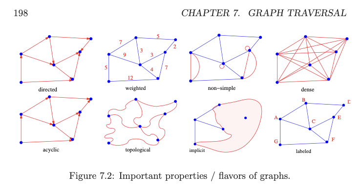

---
tags:
  - graphs
  - graph-basics
aliases:
  - types-of-graphs
---
# 3. Graph varieties
Created Wednesday 01 April 2020

## How to create unified graph structure
Suppose we have a graph E and V, and pairs are denoted by i and j.
And we're trying to create G (adjacency list/matrix/hashmap).

1. Directedness:
	- undirected - Given i and j are connected. We make both G\[i]\[j] = true and G\[j]\[i] = true.
	- directed - make G\[i]\[j] = true (read i to j) if i and j are neighbours (not on G\[j]\[i]).
2. For weighted/unweighted graphs - Store the weight from a to b in E\[i]\[j] = 2 (or whatever weight) and E\[j]\[i] = 2. Store boolean in case of unweighted.
4. Connected - is every node reachable to every other node (via any path). Or do isolated/subgraphs.
5. Self loop. Store the loops with edges\[i]\[i] as a bool. If multi-edge, store an integer.
6. Multiedge - can two nodes have multiple edges between them. each cell becomes an number (count).
7. Cyclic or not. Trees and DAGs are two types of graphs without cycles. DAGs arise naturally to model dependencies and planning.
8. Implicit or explicit - we have E, V before hand, or are we discovering it during traversal.
9. Labeled vs unlabeled - does each node have a unique identifier, or not.

Note: ask the above questions when presented with a graph problem

More flavors of graphs mentioned in Skiena page 198
